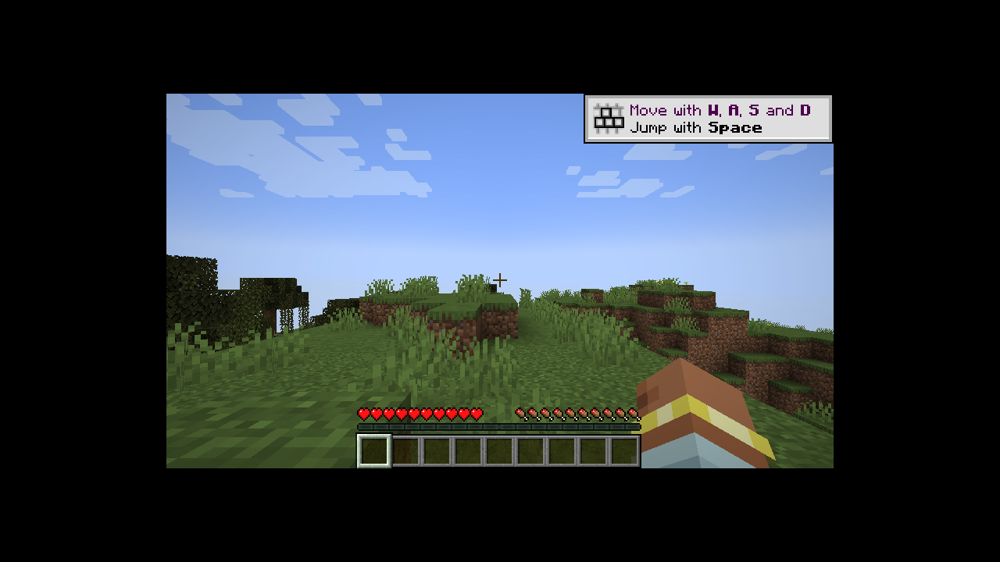
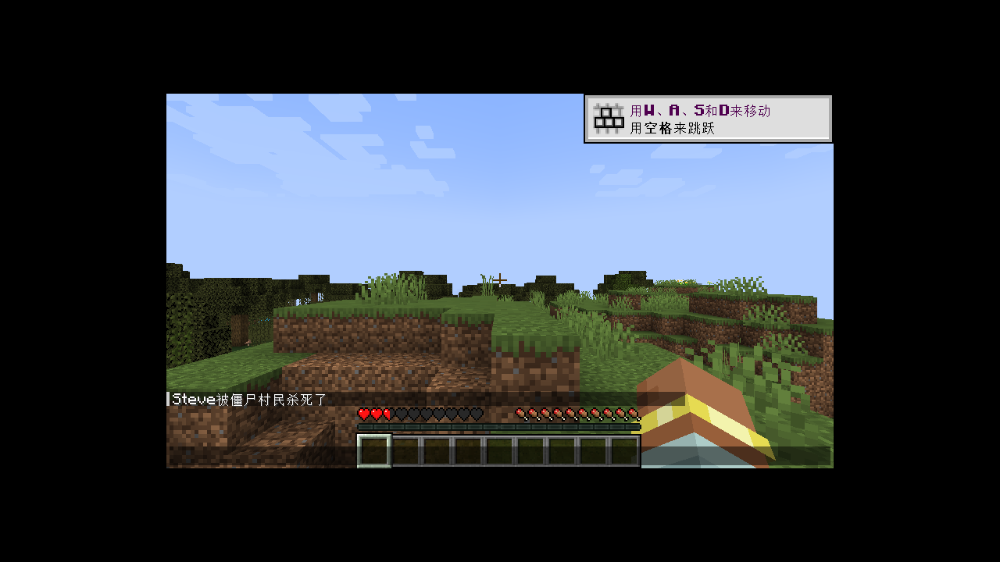

# TRCL · Tiny Runtime Craft Launcher

**Tiny Runtime Craft Launcher**：一个自己写的 Minecraft: Java 版启动器，思路对齐 HMCL（Hello Minecraft! Launcher）/ PCL（Plain Craft Launcher）：下载版本、补全依赖、拼启动参数、管实例和模组。

**形态**：Node.js 核心 + 本地 HTTP 服务 + 网页 UI，外加 Electron 外壳。
好处是同一套核心在 Windows / macOS / Linux / Android（Termux 或 proot）上都能跑，界面用浏览器打开即可，Electron 只负责开窗口和打包。

---

## 已实现

- 原版版本安装：client jar、libraries、natives、assets、log4j 配置，带 SHA1 校验、断点重下、并发下载
- 版本 JSON 继承链合并（`inheritsFrom`），兼容 Fabric / Quilt 的 profile 格式
- 启动参数拼装：新旧两套 `arguments` / `minecraftArguments`、规则（os/arch/features）、变量替换、classpath、natives 解压
- Java 检测（PATH / JAVA_HOME / 常见安装目录 / 自带 runtime）与**一键下载 JRE**（清华 Adoptium 镜像，支持 Win/mac/Linux）
- 账号：离线登录、微软设备码登录（Xbox → XSTS → Minecraft Services）、账号切换与持久化
- 加载器：Fabric、Quilt（meta API 直接生成版本 JSON）、Forge、NeoForge（调用官方 installer）
- 实例：隔离的 gameDir、内存/窗口/JVM 参数、多实例切换
- 模组：Modrinth 搜索安装（自动补 required 依赖）、启停（`.disabled`）、删除、jar 元数据解析
- 整合包：Modrinth `.mrpack` 导入（自动建实例、装加载器、下文件、解压 overrides）
- 任务系统：安装/启动/模组/整合包都跑在后台任务里，UI 轮询进度和日志
- Electron 打包配置（`electron-builder`）

## 快速开始

要求 Node.js ≥ 20（推荐 22+）。

> 要把项目搬到另一台电脑（含存档、账号、Java 路径注意事项），见 [docs/PORTING.md](docs/PORTING.md)。

```bash
npm start            # 启动本地服务
# 浏览器打开 http://127.0.0.1:34120
```

首次使用：

1. 右上角「未登录」→ 添加离线账号（或配置 client id 后用微软登录）
2. 左上角「＋」新建实例，选版本和加载器
3. 点「启动游戏」，缺文件会自动下载，缺 Java 会自动装对应大版本

### 安装包（dist/）

本机（arm64 Linux）已经产出的：

| 文件 | 平台 | 说明 |
| --- | --- | --- |
| `mc-launcher-0.1.0-linux-x86_64.AppImage` | Linux x64 | 下载后 `chmod +x` 直接运行 |
| `mc-launcher-0.1.0-linux-arm64.AppImage` | Linux ARM64 | 同上 |
| `mc-launcher-0.1.0-linux-amd64.deb` | Debian/Ubuntu x64 | `sudo dpkg -i` |
| `mc-launcher-0.1.0-linux-arm64.deb` | Debian/Ubuntu ARM64 | `sudo dpkg -i` |
| `mc-launcher-0.1.0-win-x64.zip` | Windows x64 | 便携版，解压后运行 `MC Launcher.exe` |
| `mc-launcher-0.1.0-mac-x64.zip` | macOS Intel | 解压后右键「打开」（未签名） |
| `mc-launcher-0.1.0-mac-arm64.zip` | macOS Apple Silicon | 同上 |
| `MC-Launcher-0.1.0-android-termux-arm64.tar.gz` | Android | Termux 安装包，见 `android/README.md` |

**没有 NSIS `.exe` 和 `.dmg`**：前者需要 Windows 或 wine 跑 makensis，后者需要 macOS 的 hdiutil，这台 arm64 Linux 上做不出来。Windows 的 zip 是便携版，解压即用；要安装器请走 CI。

### 用 GitHub Actions 出正式安装包

`.github/workflows/build.yml` 已配好：Windows 出 NSIS `.exe`，macOS 出 `.dmg`（x64 + arm64），Ubuntu 出 AppImage + deb。推一个 tag 就会自动构建并附到 Release：

```bash
git tag v0.1.0 && git push origin v0.1.0
```

也可以手动在 Actions 页面点 `Run workflow`，产物在 Artifacts 里。

### 本地打包

```bash
npm install                                  # 装 electron + electron-builder
npm run app                                  # 直接以桌面窗口运行
npx electron-builder --linux AppImage deb     # 或 --win nsis / --mac dmg
```

打包时注意：`build.files` 必须包含 `electron/**/*`（入口在主进程里），`asar` 已关闭，因为主进程要用 Node 子进程跑 `src/server`。

### 命令行

```bash
node src/cli.js versions
node src/cli.js java
node src/cli.js install 1.21.4
node src/cli.js create 生存 --mc=1.21.4 --loader=fabric
node src/cli.js list
node src/cli.js launch 生存
node src/cli.js search sodium --mc=1.21.4 --loader=fabric
node src/cli.js pack https://cdn.modrinth.com/data/xxx/versions/yyy/pack.mrpack
```

所有命令支持 `--dir=/自定义/数据目录`。

## 导出实例

把已安装的实例导出成其他启动器能导入的包：

| 格式 | 可导入的启动器 |
| --- | --- |
| Modrinth `.mrpack` | Prism、Modrinth App、HMCL |
| Prism / MultiMC `.zip` | Prism、MultiMC |

```bash
node src/cli.js export 生存 --format=mrpack
node src/cli.js export 生存 --format=multimc --saves=true
```

界面里点「导出实例」也可以。导出内容只包含 `mods/`、`config/`、`options.txt`（可选存档），版本文件和资源由目标启动器自己安装。

## 数据目录

默认位置：

| 平台 | 路径 |
| --- | --- |
| Windows | `%APPDATA%\MCLauncher` |
| macOS | `~/Library/Application Support/MCLauncher` |
| Linux | `~/.local/share/mc-launcher` |

可用环境变量 `MC_LAUNCHER_HOME` 覆盖。目录结构：

```
<root>/
  settings.json          # 下载源、Java、内存等
  accounts.json          # 账号（含 token，注意别外传）
  shared/                # 跨实例共享
    versions/<id>/       # 版本 JSON + client jar
    libraries/           # 依赖库
    assets/              # 资源与日志配置
  instances/<id>/        # 每个实例一个 gameDir
    instance.json
    mods/ saves/ logs/ natives/
  runtime/               # 自动下载的 JRE
  cache/                 # 版本清单、安装器缓存
```

## 微软登录

设备码流程需要你自己的 Azure 应用：

1. Azure 门户 → 应用注册 → 新注册 → 受支持的账户类型选「个人 Microsoft 账户」
2. 平台选「移动和桌面应用」，允许公共客户端流
3. 把「应用程序(客户端) ID」填到启动器设置里

然后在账号面板点「开始微软登录」，按提示在浏览器输入设备码。账号必须拥有 Minecraft: Java 版。

## Android

这套东西是在一台 Android 手机上（proot Ubuntu + Node）开发并验证的。现状要分清两层：

- **启动器本身可用**：`node src/server/index.js` 后用手机 Chrome 打开 `http://127.0.0.1:34120`，安装版本、配 Java、装模组、导入整合包都能跑。Termux 里 `pkg install nodejs` 后同理，且不需要 root。
- **在 Android 上真正启动 Java 版**：本项目不做渲染层，也无法替 PojavLauncher 解决它的图形栈。实测这台设备 Vulkan 兼容层异常、GL4ES 转译启动即崩，换任何启动器都一样。**结论：Android 端定位为管理端**，游戏在 PC 上跑；存档和实例目录可以直接拷过去。

### 自研 Android 版（`android-app/`）

另起了一个纯 Java 的 Android 工程：

- 核心已实现并在 JVM 上自检通过（28 项）：规则引擎、Maven/库去重、启动参数拼装、下载计划、并发下载 + SHA1、版本清单、完整性校验与自动补全、assets 索引、微软设备码登录、账号存储
- `android-app/app` 是 Android 骨架，能「拉清单 → 校验并补全 client/libraries/assets」、填 client id 后可走微软登录
- JRE / LWJGL patch / GL 转译 / 启动桥还没实现，见 [`android-app/README.md`](android-app/README.md)
- APK 由 `.github/workflows/android.yml` 在 CI 上构建（这台机器没有 Android SDK）

### 在这台手机上直接跑起来了（已验证）

同一台 Android 手机的 proot 里，用本项目自己的启动链路，1.21.4 + Fabric 已经进到世界：



原理：Mojang 只发 x86_64 的 LWJGL 原生库，启动器在 `linux + arm64` 上会自动把它们替换成 Maven Central 的 `natives-linux-arm64`（`applyArchCompat`），再用 Mesa llvmpipe 做软件 OpenGL。

```bash
apt install xvfb libgl1-mesa-dri mesa-utils
Xvfb :99 -screen 0 1280x720x24 +extension GLX &
DISPLAY=:99 LIBGL_ALWAYS_SOFTWARE=1 npm start
```

也可以直接用 Termux:X11 提供 DISPLAY，不走 Xvfb。

限制：纯 CPU 渲染，帧率低、会报 "Can't keep up"；没有 GPU 加速。这是 proot/Termux 场景，不等于 APK 能在 Android 上启动（APK 仍缺 JRE/LWJGL/GL 集成）。

### 游戏设置、自动语言、触屏 HUD

**游戏设置**：直接读写实例目录里的 `options.txt`，保留未知键和原有顺序。界面可改语言、渲染距离、模拟距离、图形质量、粒子、最大帧率、界面缩放、实体阴影、平滑光照。

**自动语言**：首次启动时如果 `options.txt` 还没有 `lang`，按浏览器 `navigator.language` 写入（22 种语言映射，`zh-CN → zh_cn`）。已有 `lang` 时不会覆盖玩家选择，可在设置里手动改。

**触屏 HUD**：点「HUD 触屏」进入全屏操作层。



- 按钮可拖动、可缩放，布局按实例存 `localStorage`
- 按住发送 keydown，松开 keyup（WASD/空格/Shift/Ctrl/E/T/Esc）
- 空白区域拖动发送鼠标相对移动，用来转视角
- 画面通过 `/api/screen` 截图轮询显示（约 1.4 fps），不是实时串流
- 按键通过 `xdotool` 注入，需要 Linux + `DISPLAY` + `xdotool`；Windows/macOS 上不显示 HUD 按钮

## 已验证 / 未验证

在 Linux ARM64（Android proot）上实测：

| 链路 | 结果 |
| --- | --- |
| 版本清单、版本 JSON、继承链合并 | ✅ |
| 原版 1.21.4 安装（4039 个资源文件，SHA1 校验） | ✅ |
| Fabric 0.20.1 安装、classpath 去重、启动到游戏主类 | ✅ 到 LWJGL 初始化 |
| Forge 54.1.22 安装（含 launcher_profiles.json 前置）、bootstrap/modlauncher 启动 | ✅ 到 LWJGL 初始化 |
| Modrinth 搜索 / 安装（Fabric API）、jar 元数据解析 | ✅ |
| 离线账号 | ✅ |
| 游戏设置读写（options.txt） | ✅ lang/渲染距离/图形已写入并生效 |
| 首次启动自动语言（zh-CN → zh_cn） | ✅ 中文界面截图 |
| 触屏 HUD 按键注入（xdotool） | ✅ 按 T 打出聊天框 |
| Linux ARM64：自动替换 arm64 原生库后真正进入世界（Xvfb + llvmpipe） | ✅ 1.21.4 + Fabric，截图见上 |
| 微软设备码登录 | ⚠️ 代码完整，未用真实账号跑通 |
| Quilt / NeoForge | ⚠️ 代码完整，本机网络未跑通（NeoForge maven 超时） |
| .mrpack 整合包 | ⚠️ 代码完整，未用真实包跑通 |
| Windows / macOS | ⚠️ 未在真机验证 |

ARM64 机器上最终会停在 `Platform/architecture mismatch ... linux/x64`，因为 Mojang 只提供 x86_64 的 LWJGL 原生库；x86_64 桌面不会遇到。


## 架构

```
src/core/
  meta.js      版本清单 / 版本 JSON / inheritsFrom 合并
  install.js   下载计划、库/资源/日志配置、natives 解压
  launch.js    纯函数 buildCommand + 进程启动与日志
  rules.js     Mojang 规则引擎
  java.js      Java 探测、按大版本挑选、JRE 下载
  auth.js      离线 / 微软设备码 / 账号存储
  loaders.js   Fabric / Quilt / Forge / NeoForge
  instances.js 实例 CRUD
  mods.js      模组列表与开关
  modrinth.js  搜索、安装、依赖
  modpack.js   .mrpack 导入
  zip.js       自带 ZIP/tar.gz 读取（不依赖 unzip）
src/app.js     应用层：安装、启动、快照
src/server/    HTTP API + 静态 UI
ui/            无框架网页界面
electron/      桌面外壳
```

## 已知限制

- 暂不支持 CurseForge 整合包（需要 API key），会给出明确提示
- Forge / NeoForge 依赖官方 installer，老版本可能需要 Java 8；安装器输出会实时打到日志
- 微软登录的 token 明文存在 `accounts.json`，没有做系统钥匙串加密
- 本地服务无鉴权，只监听 `127.0.0.1`；不要改成 `0.0.0.0` 暴露到公网
- 没有做自动更新、皮肤站、服务器列表

## 测试

```bash
npm test
```

覆盖参数拼装、classpath、旧版参数、规则引擎、Maven 路径、UUID、版本合并、日志配置变量。

## 域名规划

保留域名：**863214.xyz**（当前未启用，不参与任何请求）

| 计划用途 | 状态 | 说明 |
| --- | --- | --- |
| 安装包与更新 | 未启用 | `updateBase` 指向静态站，放 exe/AppImage/APK 和 `latest.json` |
| 下载镜像 | 未启用 | `mirrorBase` 反代 Mojang 的清单/客户端/库/assets，国内加速 |

实现约定：

- `settings.json` 已预留 `mirrorBase`、`updateBase`，默认为空字符串
- 为空时全部走 Mojang 官方，行为不变；只有显式配置才会改写下载地址
- 启用前需要：域名备案（大陆服务器）、HTTPS 证书、缓存与带宽方案

## 功能状态

已实现与未实现的功能清单见 [docs/STATUS.md](docs/STATUS.md)，只记录核实过的状态。

## 许可证

**GPL-3.0-or-later**，见 [LICENSE](LICENSE)。

- 分发编译好的安装包时，必须同时提供完整对应源码。源码地址：本仓库；如果你改了代码再分发，也要公开你的修改。
- 本项目**不含** Minecraft 游戏文件（运行时下载），也**不含** PojavLauncher 代码。依赖的 Electron / electron-builder / Node 均为 MIT。
- 若分发物包含 PojavLauncher（GPLv3）代码，整个分发包按 GPLv3 处理，保留原作者声明并提供源码。

详见 [THIRD_PARTY_NOTICES.md](THIRD_PARTY_NOTICES.md)。

**二次分发**：依据 GPLv3 §7(b)，分发时必须保留 `LICENSE` 与 `NOTICE.md`，并在发行页标注来源（TRCL、上游仓库地址、作者），修改过的需说明改动。详见 [NOTICE.md](NOTICE.md)。
